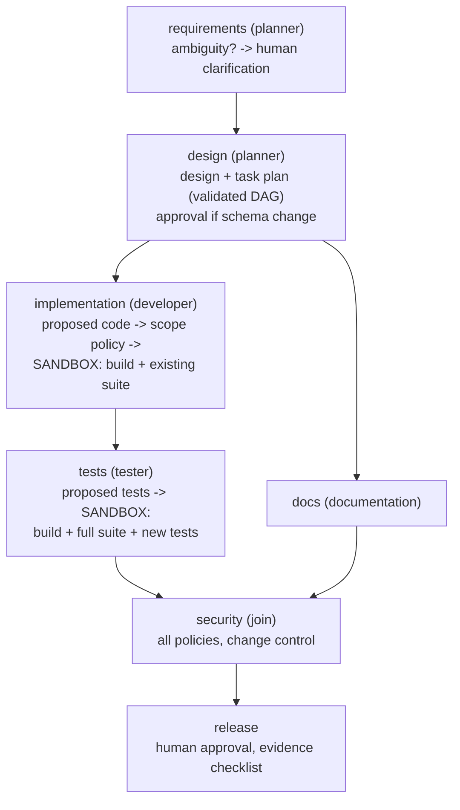

# Agentic SDLC System: URL Shortener

This repository contains two things you can run:

| | What it is | Go to |
|---|---|---|
| **1** | **Test everything**: the agentic AI tool runs all scenarios and all tests automatically | [Part 1](#part-1-test-everything) |
| **2** | **Use the URL shortener**: start the app and shorten your own link | [Part 2](#part-2-use-the-url-shortener-shorten-your-own-link) |

Only prerequisite: [.NET 8 SDK](https://dotnet.microsoft.com/download/dotnet/8.0). Open a terminal in the project folder.

---

## Part 1: Test everything

One command. It runs everything by itself and never asks for input. Pick **one** option:

| | Option A: without AI (recommended first) | Option B: with real AI agents |
|---|---|---|
| **Windows (Command Prompt)** | `run-tests rules` | `run-tests ai` |
| **Windows (PowerShell)** | `.\run-tests.ps1 -Agents rules` | `.\run-tests.ps1 -Agents ai -RequireAi` |
| **Linux / macOS** | `AGENTS=rules ./run-tests.sh` | `AGENTS=ai REQUIRE_AI=1 ./run-tests.sh` |
| Extra requirement | none | [Claude Code](https://docs.anthropic.com/en/docs/claude-code) installed and logged in, or `ANTHROPIC_API_KEY` set |
| Time / cost | about 1 minute / free | about 30 minutes / about $3 in model usage |
| Agents used | Built-in rule-based agents | Claude planner, developer, tester and documentation agents |

**What it does** (both options):
1. Builds the solution.
2. Runs 37 product tests and 69 engine tests.
3. Runs the greenfield, brownfield, ambiguous and safe-stop scenarios end to end and checks their evidence.
4. Starts the URL shortener and checks it automatically with a test link (shorten → redirect → analytics).

Proposed code is built and tested in a throw-away copy, so your files are never modified.

**Result:** the last line says **`ALL STAGES PASSED`**. The detailed report is in
`TestResults\acceptance\acceptance-report.md` (JUnit XML is also in `TestResults\`). Results of both options from our
own runs: [`docs/sample-runs/acceptance-ai`](docs/sample-runs/acceptance-ai) (92/92 checks) and
[`docs/sample-runs/acceptance-rules`](docs/sample-runs/acceptance-rules) (87/87 checks).

---

## Part 2: Use the URL shortener (shorten your own link)

This is the product on its own: no AI and no tests. Use **two terminals**.

**Step 1: in terminal 1, start the app and leave it running.** Wait for `Now listening on: http://localhost:5080`.

```
dotnet run --project src/UrlShortener.Api --urls http://localhost:5080
```

**Step 2: in terminal 2, shorten your link** (replace the URL with yours):

| Terminal | Command |
|---|---|
| Command Prompt | `curl -X POST http://localhost:5080/api/urls -H "Content-Type: application/json" -d "{\"url\":\"https://example.com/a/very/long/path\"}"` |
| PowerShell | `Invoke-RestMethod -Method Post -Uri http://localhost:5080/api/urls -ContentType "application/json" -Body '{"url":"https://example.com/a/very/long/path"}'` |
| Linux / macOS | `curl -X POST http://localhost:5080/api/urls -H 'Content-Type: application/json' -d '{"url":"https://example.com/a/very/long/path"}'` |

The response contains your short link, for example:

```
{"code":"aB3xK9q","shortUrl":"http://localhost:5080/r/aB3xK9q","targetUrl":"https://example.com/a/very/long/path",...}
```

**Step 3: open the `shortUrl` in a browser.** It takes you to your original link.

**Optional: more things to try** (replace `aB3xK9q` with your code; Command Prompt syntax):

| What | Command |
|---|---|
| Click analytics | `curl http://localhost:5080/api/urls/aB3xK9q/analytics` |
| Link details | `curl http://localhost:5080/api/urls/aB3xK9q` |
| Custom alias that expires in 60 minutes | `curl -X POST http://localhost:5080/api/urls -H "Content-Type: application/json" -d "{\"url\":\"https://example.com/page\",\"alias\":\"my-link\",\"expiresInMinutes\":60}"` |
| Unsafe URL gets rejected (400) | `curl -X POST http://localhost:5080/api/urls -H "Content-Type: application/json" -d "{\"url\":\"http://127.0.0.1/admin\"}"` |

**Step 4: stop the app** with **Ctrl+C** in terminal 1.

---

> **Start here:** [docs/PROJECT_GUIDE.md](docs/PROJECT_GUIDE.md): what it does, what it needs, every activity, the security checks, how it is tested, the evidence, and a 10-minute demo plan.

An agentic software-engineering system that turns a requirement into a **reviewable engineering outcome** under
**governed, bounded autonomy**. Claude-powered agents (planner, developer, tester, documentation) reason and propose.
The orchestrator controls and verifies: it runs a dependency graph with quality gates, policies, artifact permissions,
real build-and-test validation in a sandbox, human approvals, retries with repair feedback, fallback, rollback,
safe-stop, re-planning, a hash-chained audit trail and reliability metrics.

| Part | What it is | Where |
|---|---|---|
| **The product** | URL shortener API with analytics (ASP.NET Core minimal API, .NET 8) | `src/UrlShortener.Api` |
| **The orchestrator** | Generic engine: DAG scheduling, state machine, gates, validation, approvals, policies, audit, metrics, persistence | `src/Agentic.Core` |
| **The model adapter** | Claude via the Claude Code CLI in headless mode; fake client for tests | `src/Agentic.Model` |
| **The SDLC agents** | AI agents (`Ai/`), rule-based fallback agents, workflow definition, sandbox validator, policies | `src/Agentic.Agents` |
| **The CLI** | Runs scenarios or your own requirement; model smoke test; cross-run metrics | `src/Agentic.Cli` |

> **The model reasons and proposes; the orchestrator controls and verifies.** Agents get no tools: they cannot read or
> write files, run commands or reach the network. Their JSON output must match a schema. It is checked by gates and policies,
> and it is proven only by actually building and testing it in a throw-away copy of the code. Proposed code is
> **never applied to the repository**; it is exported for human review.

## Quick start

Requirements: **.NET 8 SDK**. For AI agents: **Claude Code** (CLI, or the VS Code extension, which bundles the binary) logged in,
or `ANTHROPIC_API_KEY` set. Without Claude Code the default `auto` mode detects this and runs the rule-based agents.
No NuGet packages are used, so it builds offline.

```bash
dotnet build AgenticSdlc.sln

# 1. check the model adapter works (auth, model selection, structured output)
dotnet run --project src/Agentic.Cli -- --check-model

# 2. run a scenario with Claude agents; proposals are built and the real test suite runs in a sandbox
dotnet run --project src/Agentic.Cli -- --scenario greenfield

# your own requirement, with YOU as the approver on the console
dotnet run --project src/Agentic.Cli -- --requirement "Make links safer and track usage" --interactive

# deterministic, free, offline (rule-based agents, no sandbox build) - what the automated tests use
dotnet run --project src/Agentic.Cli -- --scenario all --agents rules --no-exec

# reliability metrics across all recorded runs (measurement window printed)
dotnet run --project src/Agentic.Cli -- --metrics --since 2026-10-01

# the product itself
dotnet run --project src/UrlShortener.Api --urls http://localhost:5080
curl -i -X POST localhost:5080/api/urls -H 'Content-Type: application/json' -d '{"url":"https://example.com/a/very/long/path"}'
```

### Configuration (environment variables)

| Variable | Default | Meaning |
|---|---|---|
| `CLAUDE_MODEL` | `sonnet` | Model alias or full id passed to Claude Code (`opus`, `sonnet`, `haiku`, ...) |
| `CLAUDE_CODE_PATH` | auto | Path to `claude`; otherwise PATH, `~/.local/bin`, then the VS Code extension's bundled binary |
| `CLAUDE_TIMEOUT_SECONDS` | `300` | Per model call |
| `CLAUDE_MAX_BUDGET_USD` | `1.00` | Per model call spend cap, enforced by Claude Code |
| `CLAUDE_EFFORT` | (unset) | Optional effort level |
| `AGENTIC_AGENTS` | `auto` | `auto` (Claude if installed and a live health check passes, else rule-based), `ai` or `rules` (same as `--agents`) |

Authentication is whatever your Claude Code installation is logged in with. This application never reads, stores or
logs credentials.

### Output of a run: `out/<runId>/`

| File | Content |
|---|---|
| `state.json` | Live workflow state, rewritten atomically on every transition: node states, attempts, plan version, approvals |
| `audit.live.jsonl` / `audit.jsonl` | Hash-chained audit trail, including every `model.invoked` event (model, latency, tokens, cost; never prompts) |
| `artifacts/` | Every artifact, versioned: requirement, design, plan, changeset, proposed-changes, proposed-tests, validation-report, test-report, openapi, schema, api-docs, security-report, release-checklist, engineering-summary |
| `proposed/` | The proposed source files, laid out like the repo, ready for human review. **Not applied.** |
| `run-report.json`, `decision-lineage.json`, `model-invocations.json`, `workflow.mmd` | Status and metrics, who decided what from which inputs, model calls, the graph |

`out/runs-index.jsonl` gets one line per run; `--metrics` computes run success rate, retry and rollback frequency, MTTR
and latency from it.

## Run the tests (fully automated)

One command runs the build, all unit and integration tests, and the end-to-end acceptance (SIT) suite for greenfield,
brownfield, ambiguous and safe-stop, plus a live smoke test of the URL shortener. It writes JUnit XML to `TestResults/` and
exits 0 only if everything passed. Details: [`docs/TESTING.md`](docs/TESTING.md).

```bat
run-tests            :: Command Prompt: auto (AI if available)
run-tests rules      :: Command Prompt: free, about 1 min
run-tests ai         :: Command Prompt: real Claude agents required
```
```powershell
./run-tests.ps1                         # AI if Claude Code is available, else rule-based
./run-tests.ps1 -Agents rules           # deterministic and free (CI on every commit, about 1 min)
./run-tests.ps1 -Agents ai -RequireAi   # SIT with real Claude agents (about 30 min, about $4)
./run-tests.sh                          # Linux/macOS (AGENTS=rules|ai|auto REQUIRE_AI=1)
```

CI: `.github/workflows/ci.yml` runs the rule-based gate on every push and the AI SIT run nightly or on demand.

Individual suites:

```bash
dotnet run --project tests/UrlShortener.Tests   # product: unit + in-process HTTP integration tests (37)
dotnet run --project tests/Agentic.Tests        # engine, state machine, AI agents (fake model), adapter, sandbox, scenarios (69)
dotnet run --project tests/Agentic.Tests -- Sandbox   # optional name filter
dotnet run --project tests/Agentic.Acceptance -- --agents rules   # acceptance suite only
```

The automated tests use a **fake model client** (deterministic, free). One test runs the **real sandbox**: it builds the
product, runs the real suite with a deliberately failing proposed test, and asserts that the failure is detected and the
repository is untouched. The live model is exercised by `--check-model` and by running scenarios.
The tests use a tiny xUnit-compatible shim (`tests/Shared/MiniXunit.cs`) so the build needs no NuGet access.

## The workflow



## Scenarios

| Scenario | Requirement | What it demonstrates |
|---|---|---|
| **greenfield** | Build a URL shortener (create, alias, expiry, redirect, analytics, deactivate, rate limit, unsafe-URL blocking) | Decomposition into a validated task DAG; developer and docs **in parallel**; an injected failure is **retried and rolled back** (MTTR measured); a reviewer comment on docs triggers a **partial re-plan** |
| **brownfield** | Let owners extend a link's expiry and show remaining time in stats | **Impact analysis on the real source**; developer proposes real code changes that must **build and pass the existing suite**; schema change **needs approval**; a reviewer change request re-plans **from design**; docs fall back after repeated failure |
| **ambiguous** | "Make our links safer and faster." | Ambiguity detected; run **pauses for clarification**; answers become explicit assumptions and measurable NFRs; re-plan with the new requirement |
| **safe-stop** | Greenfield, but a credential leaks into the implementation output | Critical **policy** violation: output **rolled back**, run **safe-stopped**, nothing released |

## How it maps to the requirements

| Requirement | Where |
|---|---|
| Requirement interpretation, ambiguity, assumptions, acceptance criteria | `AiRequirementsAgent` (planner) + `RequirementsGate` (human clarification) |
| Task decomposition and dependency graph | `AiArchitectAgent` -> `plan` artifact, checked by `PlanValidator` (DAG, coverage, roles); stage DAG in `SdlcWorkflow` |
| Scheduling, state transitions, sync, retries, cancellation, re-planning | `WorkflowEngine`, `NodeStateMachine` (14 states, illegal transitions rejected) |
| Developer proposes, never applies | `AiDeveloperAgent` -> `ProposedChanges { Applied = false }`, `ChangeGuard`, `ProposedChangesPolicy` |
| Tester: proposed vs executed tests | `AiTesterAgent` + `TestReport.ProposedTestsExecuted / NotExecuted` from the real runner |
| Real test execution and quality gates | `SandboxValidator` (exit code + runner output are the source of truth), `WorkflowNode.Validation` |
| Controlled repair attempts | Failure reason -> `AgentRequest.PreviousFailure` -> bounded retry |
| Model integration, config, auth, timeouts, empty/invalid output | `Agentic.Model`: `ClaudeCodeModelClient`, `ClaudeCodeOutputParser`, `ModelOptions`, `ModelException` |
| Mock agents for deterministic tests | `FakeModelClient`; rule-based agents |
| Distinct roles and permissions | `WorkflowNode.Role` + `Produces` (artifact write permission); no tools for the model |
| Human approval for high-impact actions | `ApprovalSpec` (schema change, release); no decision = reject |
| Policies | `NoSecretsPolicy`, `RequiredControlsPolicy`, `ChangeControlPolicy`, `NoPiiPolicy`, `ProposedChangesPolicy` |
| Failed dependencies never proceed silently | `FailNode`: dependents `Blocked` with a recorded decision |
| Persistence | `state.json` (live), versioned artifacts, audit log, `runs-index.jsonl` |
| Observability and metrics | `AuditLog` (hash chain, PII redaction), `MetricsCollector`, `RunHistory.Summarize` (windowed) |

## Sample runs (`docs/sample-runs/`)

| Folder | Mode | Outcome |
|---|---|---|
| `greenfield`, `brownfield`, `ambiguous`, `safe-stop` | `--agents rules --no-exec` (deterministic) | Completed, Completed, Completed, SafeStopped (as expected) |
| `acceptance-ai` | Automated SIT, Claude agents | **PASSED 92/92 checks** (build, 37 + 68 tests, 4 scenarios, product smoke test) |
| `acceptance-rules` | Automated suite, rule-based | PASSED 87/87 |
| `live-ai-greenfield` | Claude agents + real sandbox | Completed: 49/49 tests passed in the real runner, 12 of them written by the AI tester; $0.81 |
| `live-ai-brownfield` | Claude agents + real sandbox | Completed: "extend expiry" implemented as 7 proposed source files; schema change approved; reviewer change request re-planned from design (plan v2); AI tests that were wrong about existing behaviour were caught by the real runner and repaired; 48/48 tests passed (11 AI-written); docs fell back to the rule-based agent after injected failures; 12 model calls, $1.59 |
| `live-ai-ambiguous` | Claude agents + real sandbox | Completed: "Make our links safer and faster" -> 2 clarification rounds (answers matched to the right questions; unanswered follow-ups recorded as explicit assumptions) -> 6 measurable requirements incl. p95 < 50 ms at 500 req/s; 48/48 tests passed (11 AI-written); $0.55 |
| `live-ai-greenfield-blocked` | Claude agents + real sandbox | Failed: AI code broke an existing test (caught and repaired), then tester coverage stayed incomplete, so release was **blocked** |

More: [`docs/ARCHITECTURE.md`](docs/ARCHITECTURE.md), [`docs/ENGINEERING_SUMMARY.md`](docs/ENGINEERING_SUMMARY.md),
[`docs/INTERVIEW_QA.md`](docs/INTERVIEW_QA.md), [`docs/sample-runs/`](docs/sample-runs).
