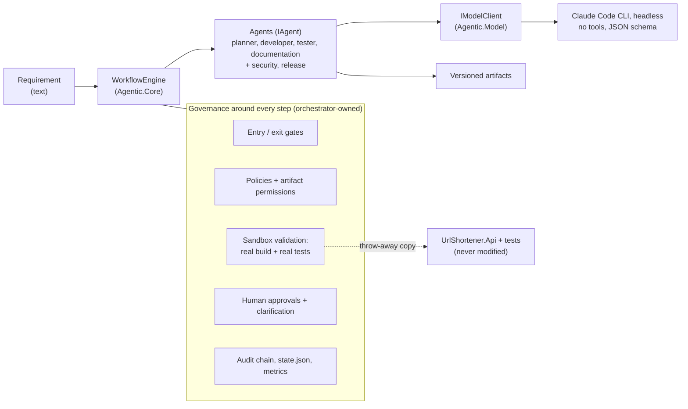
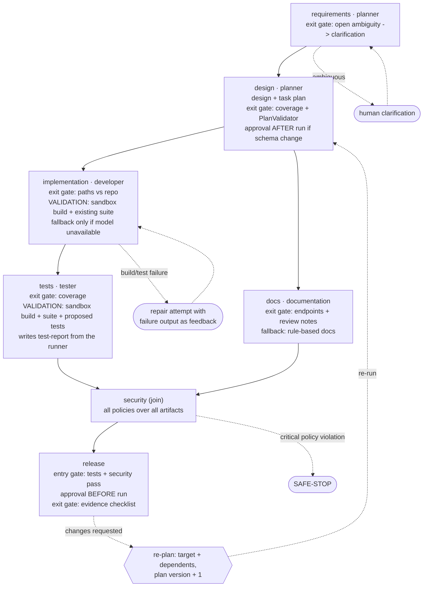
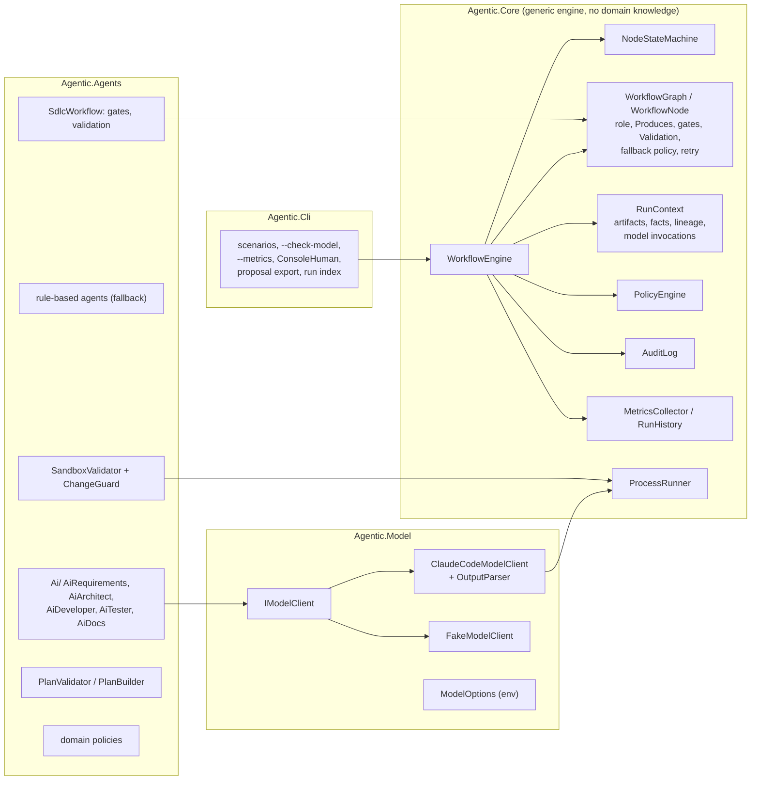
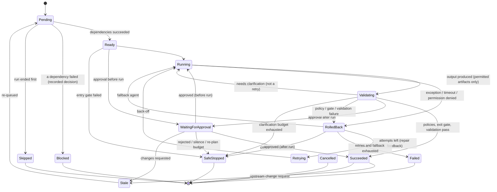

# Architecture

## 1. Big picture

The model reasons and proposes; the orchestrator controls and verifies. Agents have **no tools**. They receive a
prompt assembled by orchestrator code (including read-only repository context) and return JSON that matches a schema.

## 2. The SDLC workflow (stage graph)

Two levels of plan:
- **Stage graph** (above): fixed governance structure in `SdlcWorkflow`. It decides who may do what, which gates and
  validations apply, and where humans approve.
- **Task plan** (`plan` artifact): produced by the planner (model), with tasks, roles, dependencies, covered requirements,
  expected outputs, risks and validation criteria. `PlanValidator` accepts it only if it is an acyclic graph, every
  dependency exists, every role is known, and every functional requirement has a developer task and a tester task.
  The developer and tester agents work from their tasks. Re-planning produces a new plan version.

The model can shape the work, but it cannot remove a gate, an approval or a validation.

## 3. Components

## 4. Node lifecycle (enforced state machine)

Only the engine changes states, and only along `NodeStateMachine`. An illegal transition throws, so a bug cannot
silently corrupt workflow state.

Any in-flight state can also go to `Cancelled` when the run is safe-stopped.

Run status: `Completed` (all succeeded), `Failed` (a node exhausted its retries; its dependents are blocked, independent
branches still finished; nothing unsafe happened), or `SafeStopped` (governance stop: critical policy, rejection, kill
switch, budget exhausted).

## 5. What the engine does for one node

1. **Entry gate** fails -> safe-stop (a broken precondition is not retryable).
2. **Approval before run** if declared (release).
3. Snapshot context -> run the agent with a timeout and `PreviousFailure` (null on the first attempt).
4. **Permission check**: every artifact must be in the node's `Produces` list; otherwise the attempt fails and nothing is stored.
5. **Policies** on the new output: *Critical* -> rollback + safe-stop (no retry); *High* -> failure; *Warning* -> logged.
6. **Exit gate**: pass, fail, or needs clarification (ask the human, re-run, bounded).
7. **Validation** (orchestrator-owned, async): e.g. build and run the real tests in a sandbox. Evidence artifacts
   (validation report, test report) are stored even when it fails, so lineage shows what was tried.
8. Failure path: **rollback** -> **retry** with back-off and the failure text as repair feedback (bounded) -> **fallback agent**
   (`AfterRetries`, or `OnlyWhenUnavailable` where a weaker agent would hide a real failure) -> **Failed**, dependents **Blocked**.
9. Success: decision recorded with inputs and outputs; recovery time measured if it failed before.
10. **Approval after run** if declared (schema change); *changes requested* -> **re-plan**.

## 6. Model integration (Agentic.Model)

`ClaudeCodeModelClient` runs `claude -p --output-format json` with:

| Flag | Why |
|---|---|
| `--tools ""` | no built-in tools: the model cannot read or write files or run commands |
| `--strict-mcp-config`, `--disable-slash-commands`, `--safe-mode` | no MCP servers, skills, hooks, plugins or user CLAUDE.md: a clean, reproducible agent |
| `--no-session-persistence`, `--permission-prompts none` | nothing saved; anything that would ask for permission is denied |
| `--json-schema` | structured output validated by Claude Code; the orchestrator validates it again |
| `--model`, `--max-budget-usd`, `--effort` | configuration from environment variables |
| prompt on **stdin**, arguments as a list | no shell, no command injection, no command-line length issues |

The working directory is an empty temp folder. `ClaudeCodeOutputParser` maps the result envelope to a response
(structured output, actual model, tokens, cost) or to a classified `ModelException`:

| Kind | Retryable | Engine reaction |
|---|---|---|
| NotConfigured, Authentication, ModelUnavailable, BudgetExceeded | no | `NonRetryableAgentException` -> straight to the rule-based fallback |
| RateLimited, ServiceUnavailable, Timeout, EmptyResponse, InvalidOutput, ProcessFailed | yes | retry with back-off |

Every call is recorded as a `ModelInvocation` (role, model, outcome, latency, tokens, cost; no prompt text) and
audited as `model.invoked`.

## 7. Validation: proposals are proven, not trusted

`SandboxValidator` copies `src/UrlShortener.Api`, `tests/UrlShortener.Tests`, `tests/Shared` and `nuget.config` to a temp
folder. It applies proposed files only after `ChangeGuard` accepts them:
- relative paths only, no `..`
- only `src/UrlShortener.Api/` and `tests/UrlShortener.Tests/`
- `.cs` files only
- the test runner entry point is protected
- create/modify only, no deletes
- size and count limits

It then runs `dotnet run --project tests/UrlShortener.Tests` with a timeout, and parses the exit code, totals, per-test
PASS/FAIL lines and compiler errors. The temp folder is deleted afterwards.

- **implementation** validation: developer's changes + existing suite. Failure (compile errors or failing tests) goes
  back to the developer as repair feedback.
- **tests** validation: developer's changes + tester's proposed tests + full suite. The `test-report` is written by the
  orchestrator from the runner's output. It lists which proposed tests were executed and which were not. A proposed
  test that never ran fails the stage.

The release checklist requires the executed results. In `--no-exec` mode everything is labelled `NOT EXECUTED` /
`UNVERIFIED`.

## 8. Re-planning

A reviewer answers an approval with `request_changes:<node>:<note>`. The engine:
- records the change request (agents read it)
- marks the target and all transitive dependents `Stale -> Pending`
- keeps unaffected branches
- increments the plan version, logs `replan`
- enforces `MaxReplans`

The planner must echo design change requests verbatim (`appliedChangeRequests`), and docs must quote review notes, so the
gates can check that the feedback was actually applied.

## 9. Key design decisions

| Decision | Why | Alternative |
|---|---|---|
| Claude through Claude Code headless | Uses the developer's existing login; no SDK dependency; built-in schema validation and budget caps | Anthropic HTTP API with an API key |
| No tools for the model; orchestrator assembles context | Least privilege: nothing the model says can change disk or run code | Agentic tool use with permission prompts |
| Proposals as full files, validated in a sandbox copy | Proof by real build and tests; repository never touched | Apply patches to the working tree |
| Rule-based agents as fallbacks | A model outage degrades the run, it does not stop it; fully offline test mode | Fail the run |
| `OnlyWhenUnavailable` fallback for developer and tester | A "no change" fallback must not turn failing code into a pass | One fallback policy for everything |
| Enforced state machine | Illegal transitions are bugs and must be loud | Free-form state updates |
| Failed node -> dependents Blocked, run Failed | Precise: unsafe vs. unsuccessful are different outcomes | Safe-stop on any failure |
| Deterministic schema-change rule OR'd with the model's flag | The model cannot opt out of change control | Trust the model's flag |
| Gates are functions over the context | Cheap to test, explicit, auditable | Agent self-validation |
| Versioned artifacts + snapshot/restore | Rollback and lineage without a database | Mutable shared state |
| Hash-chained audit log, atomic `state.json`, append-only run index | Tamper-evident, crash-safe, metrics reproducible from records | In-memory counters |

## 10. Product API

| Method | Path | Notes |
|---|---|---|
| POST | `/api/urls` | body `{url, alias?, expiresInMinutes?}`; 201 (Location `/api/urls/{code}`), 200 existing (idempotent per client+URL), 400 invalid, 409 alias taken, 429 rate-limited (+`Retry-After`) |
| GET | `/r/{code}` | 302 redirect; 404 unknown; 410 expired or deactivated; click recorded asynchronously |
| GET | `/{code}` | same as `/r/{code}` (kept for links already handed out) |
| GET | `/api/urls/{code}` | metadata: code, short URL, target, created, expiry, active (owner id not exposed) |
| GET | `/api/urls/{code}/analytics` | total clicks, last access, per-day breakdown (`/stats` kept as an alias) |
| DELETE | `/api/urls/{code}` | 204 for the creator, 403 otherwise, 404 unknown |
| GET | `/health` | liveness |

Security controls:
- http/https only; no credentials in URLs
- loopback, private, link-local and metadata hosts blocked
- input and body size limits
- per-client rate limiting
- `nosniff` + `no-store` headers
- generic error responses
- collision-free codes, with code allocation retried around custom aliases
