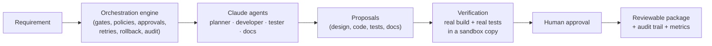
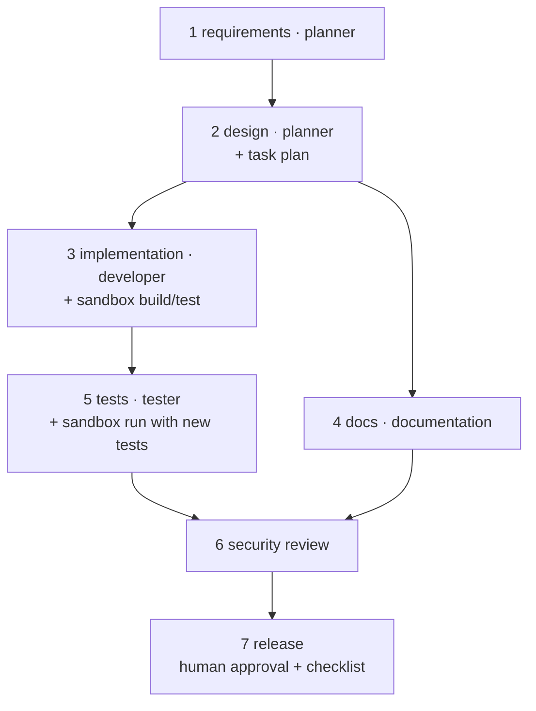

# Project Guide: Agentic Software Engineering System (URL Shortener)

This is the single document to read first. It explains what the system does, what it needs, every activity it
performs, the security it enforces, how it is tested, and where the evidence is. Deeper material is linked at the end.

---

## 1. What it is, in one paragraph

A requirement goes in, for example *"Let link owners extend the expiry of a short link"*. A team of AI agents
(planner, developer, tester, documentation), powered by **Claude** through Claude Code, analyses it, designs the
change, writes the code and the tests, and documents it. A **governed orchestration engine** written in C#
decides what runs when, checks every output with quality gates and security policies, **builds and tests the proposed
code for real** in a throw-away copy of the project, asks a human to approve high-impact steps, and records everything
in a tamper-evident audit trail. The output is a **reviewable engineering package**: requirements, design, task plan,
proposed code, executed test results, API contract, schema, documentation, security report, release checklist and an
engineering summary. A human decides whether to apply it.

The product the agents work on is a real **URL shortener API** (ASP.NET Core, .NET 8), which also runs on its own.



**Principle: the model reasons and proposes; the orchestrator controls and verifies; humans approve.**

---

## 2. How it answers the assignment

| Assignment requirement | How this system meets it |
|---|---|
| Requirement understanding, ambiguity | Planner agent normalises the requirement, asks clarifying questions when wording is vague, records explicit assumptions, writes testable acceptance criteria |
| Task decomposition with dependencies | Planner produces a task graph (developer / tester / documentation tasks with dependencies); the orchestrator rejects it unless it is acyclic and covers every requirement |
| Codebase reasoning (brownfield) | Design agent reads the real source code; impact analysis lists affected files, endpoints and data flows, checked against the repository |
| Orchestration across the full SDLC | Requirements → design → implementation ∥ docs → tests → security → release, as an explicit dependency graph |
| Non-linear, stateful execution with governance | Parallel branches with synchronisation, a 14-state lifecycle per stage, re-planning, failure isolation |
| Entry/exit gates | Every stage has preconditions and output checks |
| Cross-stage context, decision lineage | Versioned artifacts shared across stages; every decision records who, why, inputs and outputs |
| Human approval for high-impact actions | Schema changes and release need a human; silence = reject |
| Bounded retries, fallback, rollback, safe-stop | All implemented and exercised in the scenarios |
| Policy guardrails (security, compliance, change control) | 5 policies run on every output (section 6) |
| Audit-grade observability | SHA-256 hash-chained audit log, live state file, model-call log |
| Reliability metrics | Success rate, retry and rollback frequency, MTTR, end-to-end latency, per run and across runs |
| Dynamic re-planning | A reviewer's change request re-runs only the affected stages and bumps the plan version |
| Production-quality outputs | Real code that must build and pass the real test suite, OpenAPI contract, SQL schema, tests, docs |
| Validation and risk control | Sandbox execution, risk register, failure-mode tests |
| Controlled autonomy | Agents have no tools; they only propose; humans approve and apply |
| Final engineering summary | Generated for every run, plus `docs/ENGINEERING_SUMMARY.md` |
| Greenfield, brownfield, ambiguous scenarios | All three run end to end with real AI; evidence in `docs/sample-runs/` |
| Setup, testing approach, limitations, trade-offs | Sections 3, 7, 9 and 10 below |

---

## 3. What it requires

| Requirement | Why | Notes |
|---|---|---|
| **.NET 8 SDK** (or newer SDK) | Builds and runs everything | The assignment does not prescribe a stack; .NET 8 is the LTS version of the existing project. No NuGet packages are needed. |
| **Claude Code**, logged in | The AI agents call Claude through it | The VS Code extension bundles it, or `npm install -g @anthropic-ai/claude-code`. On servers, set `ANTHROPIC_API_KEY`. |
| Without Claude Code | Still runs | The default `auto` mode detects this and uses the built-in rule-based agents, and says so. |
| Windows, Linux or macOS | Runs anywhere .NET runs | `run-tests.ps1` (Windows) and `run-tests.sh` (Linux/macOS) |
| Optional: `CLAUDE_MODEL` | Choose the model | Default `sonnet`; also `CLAUDE_TIMEOUT_SECONDS`, `CLAUDE_MAX_BUDGET_USD` (per-call cost cap), `CLAUDE_EFFORT` |

Cost of a live AI scenario: about $0.50–$1.70 and 3–10 minutes. Rule-based mode: free, seconds.

---

## 4. How to run it

```powershell
dotnet build AgenticSdlc.sln

# check the AI connection (auth, model, structured output)
dotnet run --project src/Agentic.Cli -- --check-model

# run one scenario end to end with AI agents
dotnet run --project src/Agentic.Cli -- --scenario brownfield     # or greenfield, ambiguous, safe-stop, all

# your own requirement, with you as the human approver
dotnet run --project src/Agentic.Cli -- --requirement "Make links safer and track usage" --interactive

# verify everything automatically (build + all tests + acceptance suite)
./run-tests.ps1                 # AI if available
./run-tests.ps1 -Agents rules   # free, deterministic, about 1 minute

# the URL shortener itself
dotnet run --project src/UrlShortener.Api --urls http://localhost:5080
Invoke-RestMethod -Method Post -Uri http://localhost:5080/api/urls -ContentType "application/json" -Body '{"url":"https://example.com/a/long/path"}'
# open the returned shortUrl (http://localhost:5080/r/<code>) in a browser
```

Each run writes `out/<runId>/`:

| File | Content |
|---|---|
| `artifacts/` | Every artifact, versioned |
| `proposed/` | AI-written code, ready for review (**not applied**) |
| `audit.jsonl` | The tamper-evident trail |
| `state.json` | Live stage states |
| `model-invocations.json` | Every AI call with model, time and cost |
| `run-report.json` | Status and metrics |
| `decision-lineage.json` | Who decided what, from which inputs |

---

## 5. Activities: what the system does, step by step



| # | Stage (agent role) | What the agent does | What the orchestrator checks before accepting it |
|---|---|---|---|
| 1 | **Requirements** (planner, AI) | Turns the text into functional requirements with acceptance criteria, measurable non-functional requirements, assumptions, and at most 3 clarifying questions | Exit gate: open questions → pause for a human; answers stored and the stage re-runs. Every requirement needs ≥ 2 testable criteria. |
| 2 | **Design** (planner, AI) | Components, API endpoints, data model, security controls, risks and decisions, impact analysis on the real code, and the **task plan** | Entry gate: no open ambiguity. Exit gate: every requirement has an endpoint; task plan is a valid DAG covering every requirement. Policy: required security controls present. Schema change → human approval. |
| 3 | **Implementation** (developer, AI) | Proposes complete new versions of the files to change, lists compatibility risks, or explains why something is already satisfied | Scope policy (allowed folders and file types only). Paths checked against the repo. **Sandbox: copy project, apply proposals, build, run the existing test suite.** Failure output goes back to the developer for a repair attempt. |
| 4 | **Docs** (documentation, AI), in parallel with 3 | Architecture, setup, API reference, risks, limitations, review notes | Every designed endpoint documented; every reviewer note quoted |
| 5 | **Tests** (tester, AI) | Test cases for every requirement (positive + negative/edge) and executable test code | Coverage check. **Sandbox: developer's code + new tests + full suite, real test runner.** The test report is written by the orchestrator from the runner's output; proposed tests that did not run are flagged. |
| 6 | **Security** (rule-based) | Runs all policies over all artifacts | Any blocking finding stops the release |
| 7 | **Release** (rule-based) | Release checklist (10 evidence items) and engineering summary | **Human approval before running.** Every checklist item must be satisfied. |

**Around every stage**:
- snapshot the context
- run the agent with a timeout
- check artifact permissions
- run policies
- run the exit gate
- run validation
- on failure: roll back this stage's output → retry with the failure as feedback (bounded) → fallback agent → mark `Failed` and block dependents
- record the decision and audit events

**Scenario walk-throughs** (all automated in `scenarios/*.json`):
- **Greenfield**: build the shortener. An injected failure is retried and rolled back (MTTR measured). A reviewer comment on docs re-plans only docs, security and release.
- **Brownfield**: add "extend expiry" to the existing service. Impact analysis on real files; schema change approved by a human; a reviewer's "Add audit logging" re-plans from design; the docs agent is made to fail and its fallback takes over.
- **Ambiguous**: "Make our links safer and faster." Clarifying questions, answers matched to questions, unanswered follow-ups recorded as assumptions, measurable targets (p95 < 50 ms).
- **Safe-stop**: a credential leaks into generated output. The security policy rolls it back and stops the run; nothing is released.

---

## 6. Security: everything it checks

### 6.1 Controls on the AI itself (least privilege)

| Control | What it prevents |
|---|---|
| Claude runs with **no tools** (`--tools ""`), no MCP servers, no plugins/hooks (`--safe-mode`), empty working folder, permission prompts auto-denied | The model cannot read or write files, run commands or use the network |
| Prompt sent on **stdin**; arguments passed as a list (no shell) | Command injection |
| Requirement and reviewer text framed as **data, not instructions** | Prompt injection |
| Output must match a **JSON schema**, then is parsed into typed records and validated | Free-form or malformed output reaching downstream stages |
| **Per-call budget cap** and timeout | Runaway cost or hangs |
| Credentials never read, stored or logged; prompts never logged | Credential and data leakage |

### 6.2 Policies run on every artifact

| Policy | Severity | Rule |
|---|---|---|
| `SEC-001-no-secrets` | **Critical** (rollback + stop the whole run) | No passwords, API keys, tokens, AWS keys or private keys in any artifact |
| `SEC-002-required-controls` | High (stage fails, repair attempt) | A design exposing link creation must include URL-scheme allow-list, SSRF block, input limits, rate limiting |
| `SEC-003-change-scope` | High | Proposed code only in `src/UrlShortener.Api/` and `tests/UrlShortener.Tests/`, `.cs` files only, relative paths, no `..`, no deletes, no build/project files, test runner protected, size and count limits; a proposal may never claim to be applied |
| `CHG-001-change-control` | High | Schema changes need a recorded human approval for the latest design; tests must have passed before security sign-off |
| `CMP-001-no-pii` | Warning | No email addresses in artifacts (logged); the audit log redacts them automatically |

### 6.3 Governance controls

- Per-stage **artifact permissions**: a stage may only write its declared outputs.
- **Human approval** for schema changes and release. No decision = reject.
- Proposed code is **never applied** to the repository. It is validated in a temporary copy and exported for review. The acceptance suite proves this by fingerprinting the repo before and after.
- Rule-based fallback is **not allowed** to replace developer or tester output after real failures, because a "no change" fallback would hide a genuine failure.
- **Tamper-evident audit**: every entry contains the hash of the previous one; the chain is verified at the end of every run.

### 6.4 Security of the URL shortener product

- Only `http` and `https` targets; no credentials embedded in URLs.
- Blocks loopback, private, link-local and cloud-metadata hosts (SSRF / open-redirect abuse).
- URL length and request body size limits.
- Per-client rate limiting with `Retry-After`.
- Owner-only deactivation; the owner id is never exposed.
- Short codes are not enumerable (scrambled ids).
- Security headers (`nosniff`, `no-store`); generic error responses.

---

## 7. How testing is done

**Everything is automated.** One command runs every level and exits non-zero on any failure:

```powershell
./run-tests.ps1                         # Windows (Linux/macOS: ./run-tests.sh)
```

| Level | Count | What it proves |
|---|---|---|
| Build | 1 | Whole solution compiles, 0 warnings |
| Product tests | 37 | URL shortener: unit tests + real HTTP integration tests (in-process server, controllable clock) |
| Engine tests | 70 | Every orchestration control **including its failure path**: scheduling, parallelism, state machine, retries, rollback (incl. parallel-branch safety), fallback, safe-stop, approvals, re-planning, policies, permissions, audit, metrics, persistence; AI agents with a fake model; Claude Code adapter; sandbox (including one real build-and-test run) |
| Acceptance (SIT) | 87+ checks | All 4 scenarios end to end, judged on their **evidence** (artifacts, audit trail, lineage, metrics, real test results), repository-unchanged check, live product smoke test (shorten → redirect → analytics, unsafe URLs, 404s) |

Outputs:
- JUnit XML for CI dashboards: `TestResults/product.junit.xml`, `engine.junit.xml`, `acceptance/acceptance.junit.xml`
- a readable `TestResults/acceptance/acceptance-report.md`

**Two modes:**

| Mode | When | Cost / time |
|---|---|---|
| `-Agents rules` | Every commit (CI). Deterministic, no secrets | Free, about 1 minute |
| `-Agents ai -RequireAi` | SIT / nightly. Real Claude agents; fails if Claude is not usable | About $4, 25–35 minutes |

AI output varies, so in AI mode a failed scenario is re-run once and any re-run is reported as `FLAKY`, never hidden.

**CI**: `.github/workflows/ci.yml` runs the rule-based gate on every push and the AI SIT nightly or on demand (needs
an `ANTHROPIC_API_KEY` repository secret). Any other CI server can call the same script and publish the JUnit files.

**Source of truth**: test pass/fail always comes from the real test runner's exit code and output, never from an AI
agent's claim.

---

## 8. Evidence (real runs)

| Run | Result |
|---|---|
| `docs/sample-runs/live-ai-greenfield` | Completed: 49/49 tests passed in the real runner, 12 written by the AI tester |
| `docs/sample-runs/live-ai-brownfield` | Completed: "extend expiry" implemented; schema change approved; re-plan from design; 48/48 passed, 11 AI-written; the AI repaired a failing test using the runner's output |
| `docs/sample-runs/live-ai-ambiguous` | Completed: vague requirement → clarifications → measurable targets; 48/48 passed |
| `docs/sample-runs/live-ai-greenfield-blocked` | Failed by design: AI code broke an existing test (caught and repaired), then test coverage stayed incomplete, so **release was blocked** |
| `docs/sample-runs/acceptance-ai` | **Automated SIT with real AI: PASSED 92/92 checks**: build, 37 + 68 tests, all four scenarios and the product smoke test, about $3 |
| `docs/sample-runs/acceptance-rules` | Same suite, rule-based agents: PASSED 87/87 in about 20 s |
| `docs/sample-runs/{greenfield,brownfield,ambiguous,safe-stop}` | Deterministic runs of all four scenarios |

**Bugs found by the automation** (both fixed, with regression tests):
1. A design check was too strict and gave unactionable feedback, so the AI could not repair it. It now explains what is expected.
2. A **concurrency bug**: a failing stage's rollback erased a parallel stage's output. Found by the AI SIT run because AI
   timing produced an interleaving that the deterministic tests never did. The governance layer refused to release
   instead of shipping without docs.

---

## 9. Key decisions and trade-offs

| Decision | Why | Trade-off |
|---|---|---|
| C# / .NET 8 | Typed, testable, production-style; matches the existing project | Not the Python spec some teams use; the assignment is stack-neutral |
| Claude via Claude Code (headless) | Uses an existing login, schema-validated output, budget caps, can be locked down | Requires Claude Code on the machine; `auto` falls back to rules without it |
| Agents propose, never apply | Humans own final quality; the repository cannot be damaged | A human must apply the exported changes |
| Real build + test in a sandbox copy | Proof instead of trust | Each validation takes tens of seconds |
| Rule-based agents as fallbacks | Model outages degrade the run instead of stopping it; free deterministic CI mode | Rule-based output is simpler than AI output |
| Explicit 14-state machine, illegal transitions throw | Bugs surface loudly; state is auditable | More states to reason about |
| Failed stage → dependents Blocked, run `Failed` (not safe-stopped) | "Unsuccessful" and "unsafe" are different outcomes | — |
| In-memory storage in the product | Runs anywhere, fast to test | Single instance only (production path: SQL + Redis) |

---

## 10. Limitations (stated openly)

- AI output varies between runs; a live run can need repairs or end `Failed` (with release blocked). Gates make this safe, not deterministic.
- Proposed code is exported for review, not applied automatically.
- Runs are persisted but cannot be resumed after a crash.
- Non-functional targets such as "p95 < 50 ms" are recorded but not load-tested.
- Impact analysis combines a code map with model judgement, not compiler-level analysis (production: Roslyn).
- Approvals are scripted in scenarios or typed on the console; no review UI or pull-request integration.
- The product has no real authentication (client id header), and in-memory storage does not scale horizontally.

---

## 11. Repository map

| Path | What |
|---|---|
| `src/Agentic.Core` | Generic orchestration engine: graph, state machine, gates, policies engine, approvals, audit, metrics, persistence |
| `src/Agentic.Model` | Claude Code adapter, error classification, health check, auto mode, fake model for tests |
| `src/Agentic.Agents` | SDLC workflow, AI agents (`Ai/`), rule-based agents, sandbox validator, policies, scenarios |
| `src/Agentic.Cli` | Command-line tool |
| `src/UrlShortener.Api` | The product |
| `tests/UrlShortener.Tests` | Product tests (37) |
| `tests/Agentic.Tests` | Engine and agent tests (68) |
| `tests/Agentic.Acceptance` | Automated acceptance / SIT suite |
| `scenarios/` | Greenfield, brownfield, ambiguous, safe-stop definitions (requirement, scripted human, injected faults) |
| `run-tests.ps1`, `run-tests.sh`, `.github/workflows/ci.yml` | Test automation and CI |
| `docs/` | This guide, architecture, testing, engineering summary, interview Q&A, sample runs |

---

## 12. Suggested 10-minute demo for the interview

1. **Problem and principle** (1 min): section 1 diagram. "The model proposes, the orchestrator verifies, humans approve."
2. **Prove AI is live** (30 s): `dotnet run --project src/Agentic.Cli -- --check-model`.
3. **Show a finished run** (3 min): open `docs/sample-runs/live-ai-brownfield/.../audit.jsonl`, `artifacts/plan.v*.json`,
   `artifacts/test-report.v*.json` (real runner, AI-written tests executed), `proposed/` (code not applied),
   and the engineering summary.
4. **Governance in action** (2 min): `live-ai-greenfield-blocked`. AI broke a test, the sandbox caught it, and the release was blocked.
5. **Automation** (2 min): `./run-tests.ps1 -Agents rules`. Build, 105 tests and 87 acceptance checks in about a minute; show the JUnit and Markdown reports.
6. **Product** (1 min): start the API, shorten a link, open it, show analytics.
7. **Limitations and next steps** (30 s): section 10.

## Further reading

- [README.md](../README.md): quick start and configuration
- [ARCHITECTURE.md](ARCHITECTURE.md): components, state machine, control flow, design decisions, API
- [TESTING.md](TESTING.md): test levels, acceptance checks, SIT/CI setup
- [ENGINEERING_SUMMARY.md](ENGINEERING_SUMMARY.md): plan, artifacts, risk register, assumptions, limitations
- [INTERVIEW_QA.md](INTERVIEW_QA.md): likely questions with short answers
